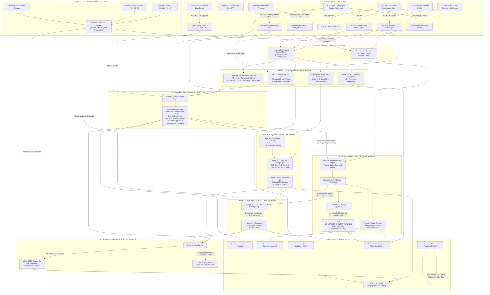

# FLOOD-X — FINAL ARCHITECTURE & FEATURE MAP
## End-to-End Decision Pipeline, Component Connectivity, and Technical Gap Analysis

- **Project:** FLOOD-X — AI-Powered Dynamic Flood-to-Action Decision Intelligence Platform
- **Target Basin:** Pune / Mula-Mutha River Basin, Maharashtra, India
- **Audit Date:** 6 November 2026
- **Auditor Role:** Lead Systems Architect & Scientific QA Reviewer

---

## 1. End-to-End Operational Pipeline: Predict to Re-Plan

The vision of FLOOD-X is to integrate seven core analytical and operational stages into a unified lifecycle:

$$\text{PREDICT} \longrightarrow \text{ASSESS} \longrightarrow \text{PRIORITIZE} \longrightarrow \text{ROUTE} \longrightarrow \text{ALLOCATE} \longrightarrow \text{EXPLAIN} \longrightarrow \text{RE-PLAN}$$

The diagram below maps how telemetry, environmental rasters, ML inference, and optimization algorithms flow through the backend services to the user interfaces, highlighting the integration status of each transition.

---

## 2. Component-by-Component Connection Audit

### 2.1 Connected and Working Pathways

1. **Environmental Ingestion to Feature Store:**
   - `CWPRSIngestionService` reads `rainfall_tel_hr_cwprs_mh_sample.csv`, detects 08:30 IST cumulative resets, and writes clean derived 5-minute increments into PostgreSQL `rainfall_observations`.
   - Feature engineering script (`run_feature_engineering.py`) calculates rolling sums (15m, 30m, 1h, 3h, 6h, 12h, 24h), Tetens Vapor Pressure Deficit (VPD), and stores aligned outputs in Parquet.
2. **Prospective Rule-Based Risk Engine:**
   - `ProspectiveRiskEngine` evaluates Open-Meteo NWP forward horizons (6h, 12h, 24h, 48h) against CPHEEO drainage proxy ($25\text{ mm/h}$) and Ambil Odha convective threshold ($45\text{ mm/h}$).
   - Freshness tracking marks stale forecasts (>24h old) as `DATA_INSUFFICIENT`.
3. **Road Network Graph and Routing:**
   - `graph_builder.py` constructs a `MultiDiGraph` (961 nodes, 1,488 directed edges) from 906 OSM arterial roads with UTM 43N metric projection.
   - `routing_algorithms.py` runs Dijkstra and A* pathfinding with configurable profiles (`FASTEST`, `SAFEST`, `BALANCED`).
   - Hard edge exclusion ($\infty$ cost) successfully detours traffic around flooded or manually barricaded roads.
4. **Prioritization to OR-Tools Dispatch:**
   - `PriorityAssessmentService` ranks sectors using the multi-criteria formula.
   - `OptimizationEngine` formulates a Mixed-Integer Program (MIP via SCIP solver) that takes sector demands, available inventory, and NetworkX travel times to generate resource dispatch plans.
5. **Session Revocation & Security:**
   - Server-side HttpOnly cookie sessions (`floodx_session`) with CSRF tokens (`floodx_csrf_token` vs `X-CSRF-Token`).
   - Persistent database model `RevokedSession` (`revoked_sessions` table) invalidates sessions across worker restarts.

---

## 3. Disconnected Modules and Architectural Gaps

### 3.1 Overview Page Map Disconnection (`BasinLeafletMap.tsx`)
- **Location:** `frontend/src/components/map/BasinLeafletMap.tsx`
- **Issue:** The component renders 100% hardcoded static data:
  - Line 18 imports `apiService`, but `apiService` is never called anywhere in the file.
  - 7 bridges are defined as a static in-file array (`PUNE_BRIDGES`).
  - 6 shelters are defined as a static in-file array (`PUNE_SHELTERS`) with fabricated capacity numbers (e.g., Yerawada 800, Bhavani Peth 500), directly violating the Phase 3.2 data integrity rule requiring unverified shelters to be NULL.
  - The flood polygon (`JULY2024_FLOOD_POLYGON`) is a 19-coordinate hardcoded array in JavaScript rather than dynamic GeoJSON from `/api/v1/gis/features` or `/api/v1/impact/latest`.
- **Impact:** The primary landing map seen by users does not reflect live database state, active road closures, or real-time flood simulations.

### 3.2 Nugen Decision Intelligence API Disconnection (`nugen_service.py`)
- **Location:** `backend/app/services/resource_optimization/nugen_service.py`
- **Issue:**
  1. `NUGEN_API_KEY` and `NUGEN_API_BASE_URL` are not configured in the host environment, causing the service to report `NUGEN_UNAVAILABLE`.
  2. In lines 260–277, even if an external HTTP 200 response is received from `${base_url}/advisory`, the code **discards** `resp.json()`. It only sets `provider_name = "Nugen Live Decision Intelligence API"` while the entire advisory body, observations, and actions remain hardcoded from the local deterministic NDMA SOP generator.
  3. In line 206, calling `f"{impact_res.population_exposure.estimated_exposed_population:,}"` raises `TypeError` because population exposure was set to `None` in Phase 5.1. The `except Exception` catch block executes and re-injects a hardcoded string: `exposed_pop_str = "18,200"`, leaking an unverified population number into the advisory.
- **Impact:** Real Nugen LLM intelligence is neither verified nor integrated; the fallback engine has an active bug that circumvents demographic data suppression.

### 3.3 Missing Runtime Python Dependencies
- **Location:** Global environment / `backend/requirements.txt`
- **Issue:**
  - `requirements.txt` is missing `geopandas`, `shapely`, and `rasterio`.
  - Top-level import `import geopandas as gpd` in `backend/app/services/ingestion/osm_service.py` prevents `app.main` and 10 of 17 test modules from being imported in a clean Python environment.
  - Packages `xgboost` and `ortools` are declared in `requirements.txt` but are not installed in the global Python environment.
- **Impact:** Fresh checkout setup fails immediately upon running `scripts/start-backend.ps1` or running `pytest`.

### 3.4 Live Telemetry and Data Stream Gaps
- **Khadakwasla Dam Telemetry:** Maharashtra WRD has no open streaming REST API. Real-time riverine risk cannot operate autonomously; it forces `DATA_INSUFFICIENT` unless an operator manually inputs a What-If scenario discharge.
- **Raw SAR Satellite Imagery:** `data/raw/satellite/` is absent. Flood impact overlay uses an illustrative 3-polygon vector analog digitized from municipal reports.
- **Census / Population Gridded Rasters:** Neither Census 2011 ward polygons nor WorldPop 100m rasters exist. All numerical population exposure figures are withheld (`null`).
- **Certified Shelters:** 0 verified shelters exist in the database (all 64 are unverified candidates with `NULL` capacity).
- **Physical Emergency Fleet:** 0 verified municipal vehicles or rescue boats are registered; all 23 database records are synthetic drill assets.

### 3.5 Mobile Application Disconnections
- **Location:** `mobile/`
- **Issue:**
  - No interactive map library installed (`react-native-maps` is absent from `package.json`).
  - No GPS geolocation library installed (`expo-location` is absent). The app relies on preset coordinate dropdowns.
  - No push notification service configured.
  - No native build configuration or compiled binary (`mobile/android/` does not exist; no APK/AAB).
- **Impact:** Mobile app is a UI shell running under managed Expo workflow; it cannot serve as a field-deployable offline native citizen tool.

### 3.6 Automated Re-Planning Loop Disconnection
- **Issue:** Although the architecture supports re-planning conceptually (adding closures, releasing resources, running what-if scenarios), there is no automated background daemon, message queue (e.g., Celery/Redis), or WebSocket notification pipeline to trigger re-planning automatically when rainfall or water levels change.
- **Impact:** Re-planning must be manually initiated by human operator clicks on the dashboard.

